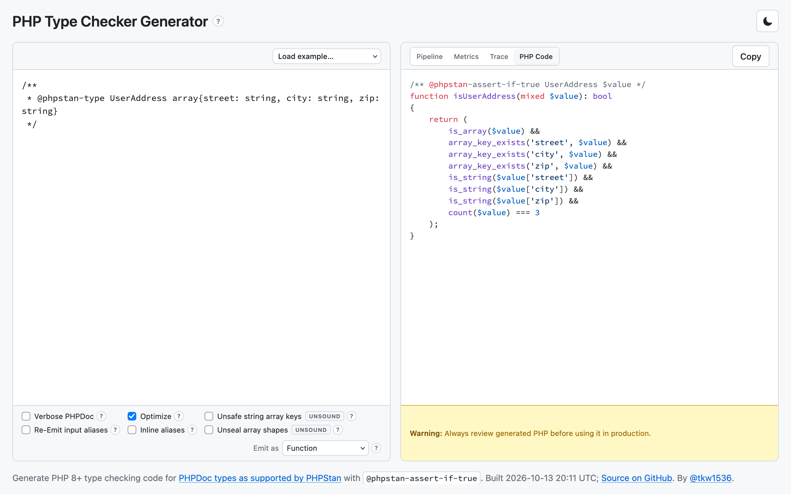
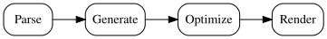
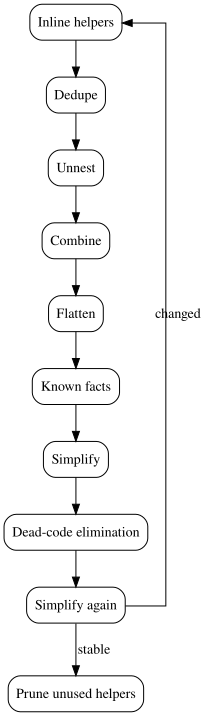

# PHP Type Checker Generator

Parse [PHPDoc types as supported by PHPStan](https://phpstan.org/writing-php-code/phpdoc-types) and generate readable PHP 8+ runtime checkers with `@phpstan-assert-if-true` — code that is meant to pass PHPStan at its strictest settings.

> **Disclaimer:** This project is vibe-coded — built quickly with minimal review. Use it at your own risk; always check any outputted code for correctness yourself.

## Try it

**[Open the live demo](https://check.guys.wtf)** — paste a PHPDoc `@phpstan-type` block (or plain types) and copy the generated PHP.



## Features

- Parse the PHPDoc types PHPStan supports (primitives, unions, shapes, generics, int ranges, aliases, and more)
- Primary input is PHPDoc with `@phpstan-type` aliases (multiple comments allowed); plain type expressions work as a convenience
- Emit standalone functions or static methods you can drop into your own code
- Shared helpers for nested types, with readable names like `isPostListResponse` by default
- UI that runs entirely in your browser — Pipeline / Metrics / PHP tabs, no server-side code or analytics

## Examples

### Docblock aliases

Input:

```php
/**
 * @phpstan-type PostSummary array{
 *   id: positive-int,
 *   slug: non-empty-string,
 *   title: string
 * }
 * @phpstan-type PaginationMeta array{
 *   page: positive-int,
 *   perPage: positive-int,
 *   total: int
 * }
 * @phpstan-type PostListResponse array{
 *   posts: list<PostSummary>,
 *   meta: PaginationMeta
 * }
 */
```

Generated PHP (excerpt — each alias is a separate check function; cross-refs call the matching function):

```php
/** @phpstan-assert-if-true PostSummary $value */
function isPostSummary(mixed $value): bool
{
    return (
        is_array($value) &&
        array_key_exists('id', $value) &&
        array_key_exists('slug', $value) &&
        array_key_exists('title', $value) &&
        is_int($value['id']) &&
        $value['id'] > 0 &&
        is_string($value['slug']) &&
        $value['slug'] !== '' &&
        is_string($value['title'])
    );
}

/** @phpstan-assert-if-true PostListResponse $value */
function isPostListResponse(mixed $value): bool
{
    if (
        !is_array($value) ||
        !array_key_exists('posts', $value) ||
        !is_array($value['posts']) ||
        !array_is_list($value['posts']) ||
        !array_key_exists('meta', $value) ||
        !isPaginationMeta($value['meta'])
    ) {
        return false;
    }
    foreach ($value['posts'] as $item) {
        if (!isPostSummary($item)) {
            return false;
        }
    }
    return true;
}
```

### Plain type expression

It is also possible to paste in a raw type expression.
For example:

```
array{foo: int, bar?: string}
```

Generated PHP:

```php
/** @phpstan-assert-if-true array{foo: int, bar?: string} $value */
function isArrayFooIntBarString(mixed $value): bool
{
    return (
        is_array($value) &&
        array_key_exists('foo', $value) &&
        is_int($value['foo']) &&
        (
            !array_key_exists('bar', $value) ||
            is_string($value['bar'])
        )
    );
}
```

## Technical Overview

Generation runs in four phases, which can be seen in the diagram below:



- **Parse**:
  Reads `@phpstan-type` aliases (or a plain type expression).
  Tokenizes PHPStan PHPDoc types, rejects cycles and duplicate aliases, and assigns check function names (`User` becomes `isUser`; unnamed types are named from the type text).
  Mentions of other phpstan-types are directly inlined into the type AST, unless configured otherwise.
- **Generate**:
  Walks each type and builds an **abstract checker**.
  The abstract checkers are represented as a very simplified PHP AST acting as an IR.

  The IR represents each checker as a so-called block, an ordered list of statements.
  A statement can be an `if` condition, a `foreach` loop, or a `return`.
  These take expressions and child-blocks as parameters.
  Each expression can be an access to a variable, a comparison, a function call, or boolean combinations thereof.

  The abstract generated checkers are fail-fast functions.
  They typically correspond to a bunch of `if (!cond) return false` plus a trailing `return true`, or `foreach` for collections.
  Simple predicates are usually boolean expressions; shapes and collections add key/property checks and loops; types that cannot be a single expression become extra helpers.
  Which exact code is generated for which type is described in more detail in the `Generate` section below.

- **Optimize**:
  Rewrites the abstract checker functions in place (helpers first, then callers) until nothing changes: inlines leftovers, boolean algebra, drop dead code, delete unused helpers.
  More details below.
- **Render**:
  This final phase writes **actual PHP**, rendering the AST into real PHP 8+ functions (or static methods) with `@phpstan-assert-if-true`.

Generate and Optimize work on abstract checkers (guards, loops, returns) that are not PHP yet; only Render emits actual PHP.
Examples below show that abstract form as PHP so it is readable.
The UI Pipeline tab exposes the same stages as JSON (`Parse`, `Generate`, `Optimize`; `Optimize` is `null` when skipped).

Generated checkers are meant to pass PHPStan at level 10; anything else is considered a bug.
Some PHPStan types cannot be checked at runtime (see Uncheckable below).

### Generate

The output of the Generate phase is very naïve.
A set of fail-fast conditions.

For example, for `int` the abstract checker looks like:

```php
if (!is_int($value)) {
    return false;
}
return true;
```

The actual implementation represents this checker using a more abstract representation, however for purposes of this document we are showing the equivalent PHP syntax.
In the UI, the Pipeline tab's `Generate` key is this naïve IR; turn Optimize off to leave `Optimize` as `null` and render from Generate.

Checkers for other types use functions other than `is_int`.
They can be seen in the following sections.

#### Scalars

| Type                      | Check                                                          |
|---------------------------|----------------------------------------------------------------|
| `int` / `integer`         | `is_int($value)`                                               |
| `string`                  | `is_string($value)`                                            |
| `float` / `double`        | `is_float($value)`                                             |
| `bool` / `boolean`        | `is_bool($value)`                                              |
| `array`                   | `is_array($value)`                                             |
| `object`                  | `is_object($value)`                                            |
| `iterable`                | `is_iterable($value)`                                          |
| `callable`                | `is_callable($value)`                                          |
| `resource`                | `is_resource($value)`                                          |
| `scalar`                  | `is_scalar($value)`                                            |
| `number` / `numeric`      | `is_int($value) \|\| is_float($value)`                         |
| `array-key`               | `is_string($value) \|\| is_int($value)`                        |
| `null` / `true` / `false` | `$value === null` / `true` / `false`                           |
| `mixed`                   | `true`                                                         |
| `never` / `noreturn`      | `false`                                                        |
| `empty`                   | `$value === false \|\| $value === 0 \|\| …` (PHP empty values) |
| `non-empty-mixed`         | `$value !== false && $value !== 0 && …` (same empties)         |

#### Int refinements and ranges

| Type               | Check                                            |
|--------------------|--------------------------------------------------|
| `positive-int`     | `is_int($value) && $value > 0`                   |
| `negative-int`     | `is_int($value) && $value < 0`                   |
| `non-positive-int` | `is_int($value) && $value <= 0`                  |
| `non-negative-int` | `is_int($value) && $value >= 0`                  |
| `non-zero-int`     | `is_int($value) && $value !== 0`                 |
| `int<0, 100>`      | `is_int($value) && $value >= 0 && $value <= 100` |
| `int<50, max>`     | `is_int($value) && $value >= 50`                 |
| `int<min, 100>`    | `is_int($value) && $value <= 100`                |
| `int<min, max>`    | `is_int($value)`                                 |

#### String refinements

| Type                                                 | Check                                                                        |
|------------------------------------------------------|------------------------------------------------------------------------------|
| `non-empty-string`                                   | `is_string($value) && $value !== ''`                                         |
| `non-falsy-string` / `truthy-string`                 | `is_string($value) && $value !== '' && $value !== '0'`                       |
| `lowercase-string`                                   | `is_string($value) && strtolower($value) === $value`                         |
| `uppercase-string`                                   | `is_string($value) && strtoupper($value) === $value`                         |
| `numeric-string`                                     | `is_string($value) && is_numeric($value)`                                    |
| `callable-string`                                    | `is_string($value) && is_callable($value)`                                   |
| `decimal-int-string`                                 | `is_string($value) && preg_match('/^-?(?:0\|[1-9]\\d*)$/', $value) === 1`    |
| `non-decimal-int-string`                             | same pattern with `!== 1`                                                    |
| `class-string` / `interface-string` / `trait-string` | `is_string($value) && class_exists($value)` (runtime cannot tell them apart) |
| `enum-string`                                        | `is_string($value) && is_a($value, \UnitEnum::class, true)`                  |

#### class-string generics

| Type                    | Check                                                                         |
|-------------------------|-------------------------------------------------------------------------------|
| `class-string<MyClass>` | `is_string($value) && is_a($value, MyClass::class, true)`                     |
| `class-string<A\|B>`    | `is_string($value) && (is_a(…, A::class, true) \|\| is_a(…, B::class, true))` |
| `class-string<A&B>`     | `is_string($value) && is_a(…, A::class, true) && is_a(…, B::class, true)`     |
| `enum-string<MyEnum>`   | `enum-string` check plus `is_a($value, MyEnum::class, true)`                  |

#### Named types and literals

| Type                     | Check                                                  |
|--------------------------|--------------------------------------------------------|
| `Foo` / `\Foo\Bar`       | `$value instanceof Foo`                                |
| `callable-array`         | `is_array($value) && is_callable($value)`              |
| `callable-object`        | `is_object($value) && is_callable($value)`             |
| `'foo'` / `42` / `69.42` | `$value === 'foo'` / `42` / `69.42` (quotes preserved) |

#### Unions, intersections, and aliases

| Type                                | Check                                                                                         |
|-------------------------------------|-----------------------------------------------------------------------------------------------|
| `int\|string`                       | `is_int($value) \|\| is_string($value)`                                                       |
| Loop-heavy union arm                | Helper call, or early `if (simpleArm) return true` then the complex arm                       |
| `Foo&Bar`                           | Consecutive checks (`&&` after Optimize); redundant `is_array` / `is_object` dropped by Optimize |
| `@phpstan-type` alias `PostSummary` | `isPostSummary($value)` (not inlined)                                                         |
| Nested non-boolean type             | Extra shared `is…` helper                                                                     |

#### Collections

Collection checks are typically represented by loops.
For example for `list<int>`:

```php
if (!is_array($value) || !array_is_list($value)) {
    return false;
}
foreach ($value as $item) {
    if (!is_int($item)) {
        return false;
    }
}
return true;
```

| Type                         | Check                                                                                                                          |
|------------------------------|--------------------------------------------------------------------------------------------------------------------------------|
| `array<T>` / `T[]`           | `is_array($value)`, then `foreach` over values                                                                                 |
| `array<K, V>`                | `foreach` checking key and value; tautological keys (`array-key`, `int\|string`, `int\|non-decimal-int-string`) and impossible key tags (e.g. `array`) optimized away |
| `list<T>`                    | `is_array($value) && array_is_list($value)`, then `foreach` values                                                             |
| `non-empty-*`                | Same as above, plus `$value !== []`                                                                                            |
| `array<mixed>` / bare `list` | Container test only                                                                                                            |
| `array<never>` / sealed `array{}` | `$value === []`                                                                                                           |
| `array{...}`                 | `is_array($value)` (unsealed empty shape)                                                                                      |
| Nested arrays                | Nested `foreach`                                                                                                               |
| Parameterized `iterable<…>`  | Not generated (foreach would not be side-effect-free)                                                                          |

The UI option **Unsafe string array keys** rewrites `array` / `non-empty-array` keys that are exactly `string` to `int|non-decimal-int-string` for runtime checks only, matching PHPStan [`reportUnsafeArrayStringKeyCasting: detect`](https://phpstan.org/blog/why-array-string-keys-are-not-type-safe).
Off (default) keeps `string` key checks — the same runtime accept set as PHPStan default / `prevent` for real PHP arrays (decimal-int-string keys are already cast to `int` before `foreach`).
`@phpstan-assert-if-true` still uses the input type as written.
Lists, value-only `array<T>`, shape rests, and other key types are unchanged.
Shape field keys that are decimal-int-strings (e.g. `'123'`) are always emitted as int literals in `array_key_exists` / `$value[…]` / foreach key compares, matching PHP key casting.

#### Shapes

Shapes represent non-homogenous containers.
These are typically represented by existence check, followed by a type check on each property.
Trailing `...` makes array and list shapes unsealed, matching [PHPStan 2.2](https://phpstan.org/blog/phpstan-2-2-unsealed-array-shapes-safer-array-keys).
Shapes without `...` are treated as unsealed for runtime checks by default (extra keys allowed) — the same as PHPStan’s default today.
Empty `array{}` / `list{}` stay empty even then: PHPStan already rejects extras on empty shapes without bleeding edge.
Truly sealed non-empty shapes (`array{a: int}` rejecting extras) are opt-in in PHPStan 2.2 via bleeding edge and are planned to become the only behavior in a future major version.

The UI option **Sealed array shapes** turns on sealed runtime checks for non-empty shapes without `...` (reject unknown keys).
`@phpstan-assert-if-true` still uses the input type as written.

Object shapes stay unsealed (no extra-property rejection; `...` is not supported on objects).
Collection field loops (`foreach`) are emitted after all key and non-loop field guards so Optimize can group them.
For example for `array{name: string, age: int}` (all keys required) with **Sealed array shapes** on, Optimize places `count($value) === 2` right after `is_array` (before key and field checks) for early reject:

```php
return (
    is_array($value) &&
    count($value) === 2 &&
    array_key_exists('name', $value) &&
    array_key_exists('age', $value) &&
    is_string($value['name']) &&
    is_int($value['age'])
);
```

Empty sealed `array{}` emits `is_array` plus `count === 0`, which Optimize rewrites to `$value === []` under the known `is_array` fact.
When any field is optional, count alone is not sound; a sealed extra-key `foreach` is used instead.
For optional keys, the value type check runs only when the key exists; optional key names still count as allowed keys when rejecting extras.
For example for `array{age?: int}`:

```php
if (!is_array($value)) {
    return false;
}
if (array_key_exists('age', $value)) {
    if (!is_int($value['age'])) {
        return false;
    }
}
foreach ($value as $key => $item) {
    if ($key !== 'age') {
        return false;
    }
}
return true;
```

Unsealed rest forms:

| Rest              | Meaning |
|-------------------|---------|
| `...`             | Any extra keys (shorthand for `...<array-key, mixed>`) |
| `...<V>`          | Extra values must be `V` (array key implied `array-key`; lists: value only) |
| `...<K, V>`       | Extra entries must be `K` ⇒ `V` (arrays only; a parse error on lists) |

In more general terms, the following shapes are supported:

| Type                                 | Check                                                                 |
|--------------------------------------|-----------------------------------------------------------------------|
| `array{foo: int, bar: string}`       | Field checks; with **Sealed array shapes**, `count($value) === 2`     |
| `array{foo: int, bar?: string}`      | Field checks; with **Sealed array shapes**, extra-key `foreach`       |
| `array{foo: int, ...}`               | Same field checks; no extra-key rejection                             |
| `array{foo: int, ...<string>}`       | Field checks; extra values checked as `string`                        |
| `array{int, string}`                 | Indexes `0`, `1`, …; with **Sealed array shapes**, `count === 2`      |
| `list{int, string}`                  | Same as array tuple, plus `array_is_list`; sealed adds `count === 2`  |
| `list{int, string, ...<bool>}`       | List tuple plus extra values as `bool`                                |
| `non-empty-array{foo: int}`          | Same as array shape with non-empty container                          |
| `object{foo: int}`                   | `is_object`; `property_exists`; `$value->foo` (not sealed)            |

#### Uncheckable

Some types cannot be checked at runtime.
These are:

- `void`:
    This represents "no value", so there is no `$value` to look at.
- `literal-string`:
    There is no way for the PHP runtime to know if a string is literal, as the [`is_literal` RFC](https://wiki.php.net/rfc/is_literal) was rejected.
- `open-resource`, `closed-resource`:
    The php runtime cannot distinguish between these.
- `static` / `self` / `parent` / `$this`:
    These are scope-dependent, and thus cannot be generically checked.
- `callable(…): …`:
    Parameter and return types cannot be verified without either calling the callable, or using reflection.
    The former introduces possible side-effects to a type checking function - which should not be the case.
    The latter could not pick up `@phpstan-type` comments and thus would not work either.
- `Foo<T>`:
    User-defined generics only exist as `@template` tags inside docblocks.
    These cannot be inspected, not even using Reflection.
- `iterable<…>`:
    When parametrized, element checks would require actually iterating.
    This would cause side-effects - which should not be the case.

### Optimize

The generated output is naïve and often generates very verbose code.
The goal of the optimize is to produce nicer code and rewrites the abstract checker in a loop until nothing changes.

An **IR** loop rewrites all checker programs until none change (do-while: Optimize enters the pass body first; **IR changed?** runs only after a round).
Inside that, each **block** runs **Inline → … → Dead-code elimination** until that block is stable.
**IR changed?** / **Block changed?** ask whether another round is needed.
IR `yes` enters the pass body again and `no` goes to **Prune**.
Block `yes` restarts at Inline and `no` returns to the IR question.
The UI Metrics tab draws this under the Optimize stage.
**Yes × N** on each loop is the round count (**IR rounds** / **Block rounds**).
The UI Trace tab is the ordered list of optimize steps, grouped by checker function (then Prune), with nested proof/reasoning (simplify normalize, fact env construction, prove/absorb implications, inline negation) as indented children.
Each checker group starts with an Initial checker step (Build IR, shown as full PHP with no Diff).
For later top-level steps, Before / After / Diff show the full checker as PHP (with a `function name(mixed $value): bool` header; Diff is a unified hunk over that same text).



| Pass                  | Goal                                                                                         | Before                                                                     | After                                                                             |
|-----------------------|----------------------------------------------------------------------------------------------|----------------------------------------------------------------------------|-----------------------------------------------------------------------------------|
| Inline helpers        | Substitute non-entry helpers at the call site (entry `@phpstan-type` checkers stay as calls) | `return isInt($elem);`                                                     | `return is_int($elem);`                                                           |
| Dedupe                | Drop identical repeated `if` / `foreach`                                                     | Two copies of `if (!is_array($value)) return false;`                       | One copy                                                                          |
| Unnest                | Collapse nested single-body `if`s into one condition                                         | `if (a) { if (b) { … } }`                                                  | `if (a && b) { … }`                                                               |
| Combine               | Merge consecutive `if`s that share the same body                                             | Separate fail-fast `if`s for `!is_array` and `!array_is_list`              | One `if` with `\|\|`                                                              |
| Flatten               | Turn a trailing `if`/`return` pair into one `return` expression                              | `if (is_int($value)) return true; return false;`                           | `return is_int($value);` (via `($cond && $b) \|\| (!$cond && $c)`, then Simplify) |
| Known facts           | Replace proven/entailed tests with a full proof trace (env seeds + derivations + equals/entails); array `foreach` keys are int or non-decimal-int-string; primary type tags are mutually exclusive; under known `is_array($x)`, `count($x) === 0` → `$x === []` | After `if (is_array($value)) return true;`, later `if (!is_array($value))`   | Later / tautological or impossible key guard is dead; Trace lists env extend + prove children |
| Simplify              | Fold boolean algebra, contradictions, factoring, and related rewrites (see below)            |                                                                            |                                                                                   |
| Dead-code elimination | Remove unreachable or empty statements; drop unused foreach `$key`; `foreach { return E }` → `if (!== [])` when `E` ignores binders | `if (false) { … }`, constant-return `foreach`                              | Removed / spliced / non-empty `if`                                                |
| Prune helpers         | Delete helpers that nothing calls anymore                                                    | Helper with no remaining callers                                           | Helper deleted                                                                    |

#### Simplify expressions

The simplify phase simplifies boolean expressions.

| Before                                             | After                                                                              |
|----------------------------------------------------|------------------------------------------------------------------------------------|
| `true` / `false` in `&&` / `\|\|`; `!!$x`          | Folded / `$x`; De Morgan for `!(a && b)` / `!(a \|\| b)`                           |
| `$x && !$x`                                        | `false`                                                                            |
| `$x \|\| !$x`                                      | `true`                                                                             |
| Duplicate operands                                 | One copy                                                                           |
| `(is_int && is_string) \|\| (is_int && is_bool)`   | `is_int && (is_string \|\| is_bool)`                                               |
| `is_a($x, Foo::class, true) \|\| class_exists($x)` | `class_exists($x)` (OR keeps the weaker fact)                                      |
| `is_a(…) && class_exists(…)`                       | `is_a(…)` (AND keeps the stronger fact; same idea for `instanceof` vs `is_object`) |
| `instanceof T && is_array($x)`                     | `false` (`instanceof` ⇒ `is_object` ⇒ exclusive ¬`is_array`)                       |
| `is_int($x) && is_string($x)`                      | `false` (primary tags are exclusive)                                               |
| `is_int($x) \|\| $x === 0`                         | `is_int($x)` (typed literals imply their `is_*` tag; OR keeps the weaker fact)     |
| `is_array($x) && $x === []`                        | `$x === []` (AND keeps the stronger fact)                                          |
| `is_array($x) && count($x) === 0`                  | `$x === []` (facts rewrite count under known `is_array`, then absorb)              |
| `array_key_exists($k, $x) && $x !== []`            | `array_key_exists($k, $x)` (key presence ⇒ non-empty)                              |
| `array_key_exists($k, $x) && count($x) !== 0`      | `array_key_exists($k, $x)`                                                         |
| `count($x) === N && $x !== []` (N≥1)               | `count($x) === N`                                                                  |
| `array_is_list($x) && count===N && key_exists(k)`  | drop `key_exists` when `0 ≤ k < N` (list of length N has keys `0..N-1`)         |
| `array_is_list($x) && $x !== [] && key_exists(0)`  | drop `key_exists(0)` (a non-empty list always has key `0`; same for `!key_exists(0)` in OR failure guards with `!list` / `=== []`) |
| `!($x !== [])`                                     | `$x === []`                                                                        |
| `!($x > 0)`                                        | `$x <= 0`                                                                          |

In practice, a lot of these combine.
For example, `list<mixed>|list<string>` becomes `is_array($value) && array_is_list($value)` because the second arm is redundant.

## Goldens

Generator success fixtures are the expected PHP checkers for each input type (or docblock).

- **Sources:** edit `src/generator/testdata/<stem>.IN`
- **Goldens:** regenerated as `<stem>.golden.php` next to that file (`yarn update_fixtures:generator`)
- **Errors:** cases that must fail generation live in `errors.json` (no PHP output)

Each `.golden.php` file is real PHP with one namespaced checker per case.
Namespaces are hashed from the case input and options so they stay unique and stable when the generated body changes.

How they are used:

- **Vitest** regenerates from the same inputs and asserts the output matches the golden body
- **`yarn check:phpstan`** runs PHPStan on the committed `.golden.php` files as-is (expects `phpstan/phpstan.phar`)

| Stem                     | Focus                                                              |
| ------------------------ | ------------------------------------------------------------------ |
| `function`               | Broad type coverage as standalone functions                        |
| `public_static`          | Same idea as a `public static` method on a class                   |
| `protected_static`       | `protected static` visibility                                      |
| `docblock`               | `@phpstan-type` docblocks → helper checkers                        |
| `docblock_emit_aliases`  | Docblocks with PHPStan type-alias emission enabled                |
| `multi_comment`          | Multiple PHPDoc comments in one input                              |
| `verbose_phpdoc`         | Multi-line Drupal-style PHPDoc on checkers                         |
| `sealed_shapes`          | Sealed array/list shapes (`sealArrayShapes`)                       |
| `errors`                 | Inputs that must throw at generation time (`errors.json` only)     |

## Develop locally

```bash
corepack enable   # once per machine, if Yarn is not available
yarn install
yarn dev          # http://localhost:5173
yarn test
yarn report:optimizer-stats   # aggregate simplify metrics over generator fixtures
yarn check:phpstan   # analyse committed *.golden.php (CI: phpstan-goldens.yml; needs phpstan/phpstan.phar locally)
yarn build
yarn lint         # Oxlint
yarn lint:fix
yarn spellcheck
```

Contributor / agent notes (fixtures, warnings, CI): see [AGENTS.md](AGENTS.md).
